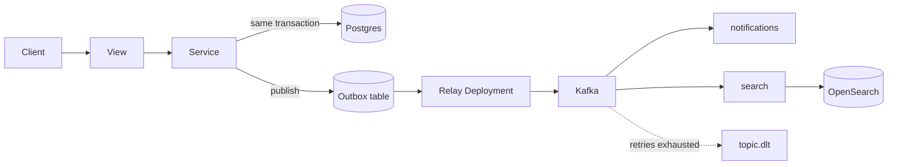

# frikkinwave — backend

[](https://github.com/uditaditya-tech/frikkinwave-backend/actions/workflows/ci.yml)
[](https://www.python.org/downloads/)
[](https://www.djangoproject.com/)

A social network for musicians and live-music professionals — jam partners, bandmates, session
players, gigs, venues, auditions. Django + DRF API, deployed on EKS.

Finding people to play with is scattered across WhatsApp groups, Instagram DMs and word of mouth.
This is a platform built for it: musicians publish profiles, and others find them by instrument,
genre, city, or full-text search.

---

## What makes it worth reading

It is built for an eventual scale it does not have yet, and the interesting part is that the
constraint is enforced rather than intended:

- **Apps never import each other's models.** They talk through service functions, so today's Python
  call becomes tomorrow's network call without the interface moving.
- **Two services are already extracted** — `apps/notifications` and `apps/search` — each with its own
  Kafka consumer group and Deployment. `apps/search` owns a store nothing else can reach and has no
  Django models at all.
- **Async work goes through a transactional outbox**, never a direct dispatch. The event row and the
  state change commit together, then a relay produces to Kafka.
- **These rules are tests, not conventions.** `tests/test_architecture.py` fails the build on a
  cross-app model import, a service that dispatches directly, a Kafka topic nobody subscribes to, or
  a consumer group with no Deployment running it.

The whole search backend was swapped from pgvector to OpenSearch without a single caller changing,
because the boundary was already `search(query=...) -> [(id, score)]`. That is the design working.

---

## Stack

| Layer | Choice |
|---|---|
| API | Django 6.0 + Django REST Framework |
| Auth | simplejwt — 15 min access, 7 day refresh, rotation + blacklist |
| Database | PostgreSQL 16 |
| Events | Transactional outbox → Kafka (Strimzi), mTLS + ACLs |
| Search | OpenSearch, BM25 over profiles |
| Contract | drf-spectacular → OpenAPI 3 |
| Runtime | Docker (arm64/Graviton) → EKS + Helm, ALB, RDS |
| Observability | Prometheus + Alertmanager → SNS |
| CI | GitHub Actions — ruff, mypy, migrate, pytest |

No Redis and no Celery: both were removed when Kafka became the only transport.

---

## How a write becomes an event



A view parses the request and calls a service. The service does the work and calls `publish()` —
inside the same transaction, so an event cannot survive a rolled-back write or vice versa. A relay
process moves rows to Kafka; consumer groups handle them at-least-once, and anything that fails past
its retry budget lands in a dead-letter topic rather than stalling a partition.

---

## API surface

All routes live under `/api/`. Auth is `Bearer <token>` except where noted.

Discovery is open and participation requires an account: browsing profiles, listings, bands and
venues needs no token, while creating or changing anything does.

| Area | Routes | Access |
|---|---|---|
| Health | `health/` | public |
| Auth | `auth/register/` · `auth/token/` · `auth/token/refresh/` | public, rate limited |
| Auth | `auth/me/` · `auth/logout/` | authenticated |
| Reference | `musicians/instruments/` · `musicians/genres/` | public |
| Discovery | `musicians/profiles/` · `profiles/<username>/` · `musicians/search/` | public |
| Own profile | `musicians/profile/` · `profile/me/` · `profile/coach/` | authenticated |
| Listings | `listings/` · `listings/<id>/` | read public, write authenticated |
| Listings | `listings/<id>/apply/` · `listings/applications/` | authenticated |
| Bands | `bands/` · `bands/<slug>/` | read public, write authenticated |
| Bands | `bands/<slug>/invite/` · `bands/memberships/` | authenticated |
| Venues | `venues/` · `venues/<slug>/` | read public, write authenticated |
| Engagements | `engagements/` · `engagements/<id>/` | authenticated |
| Connections | `connections/requests/` | authenticated |
| Social | `social/feed/` · `follow/<username>/` · `following/` · `followers/` | authenticated |
| Social | `social/<username>/following/` · `<username>/followers/` | public |
| Reviews | `reviews/` | authenticated |
| Reviews | `reviews/<username>/` · `<username>/summary/` | public |
| Docs | `schema/` · `docs/` | staff only in production |

Credential endpoints are rate limited per client IP (login 10/min, register 10/hour, refresh
60/hour), as is the Django admin login form (5/min).

---

## Running it locally

Requires Python 3.13, Docker, and [uv](https://github.com/astral-sh/uv).

```bash
uv venv --python 3.13
source .venv/bin/activate
uv pip install -r requirements/dev.txt
cp .env.example .env          # set DJANGO_SECRET_KEY
docker compose up -d          # Postgres + OpenSearch
python manage.py migrate
python manage.py seed_music_data
python manage.py runserver
```

Then `GET http://localhost:8000/api/health/` returns `{"status": "ok"}`, and
`http://localhost:8000/api/docs/` serves Swagger UI.

`docker compose` deliberately brings up no Kafka broker, so events behave differently depending on
how you are running:

- **Under pytest**, the relay runs inline and delivers to in-process subscribers, so tests drive
  events end to end with no broker at all.
- **Under `runserver`**, inline delivery is off — matching production — so `publish()` writes a row
  to the outbox and it stays there until a relay moves it.

To exercise the real path you need a broker, then run the relay and a consumer alongside the server:

```bash
python manage.py relay_outbox --loop
python manage.py consume_events --group search
```

---

## Tests

```bash
pytest
```

442 tests. Roughly 20 of them exercise a live OpenSearch cluster and **skip without one** — fine
locally, and a silent hole in CI, so `tests/test_architecture.py` asserts the CI workflow sets the
variable that opts in:

```bash
docker compose up -d opensearch
OPENSEARCH_TEST_URL=http://localhost:9200 pytest
```

Lint and types, both enforced in CI:

```bash
ruff check . && ruff format --check . && mypy apps/ config/
```

---

## Deployment

Two Terraform stacks: `infra/dns/` is persistent and must never be destroyed (Route 53 zone, ACM
cert, budget alarm, alert topic); `infra/eks/` is the disposable app stack.

```bash
./infra/scripts/eks-up.sh        # ~35 min — VPC, EKS, RDS, OpenSearch, Kafka
./infra/scripts/app-deploy.sh    # ~5 min  — build, push, helm upgrade, verify
```

The stack is deliberately **ephemeral**: brought up for a working session and torn down after, at
roughly $0.30/hour while running. `api.frikkinwave.com` is therefore live on demand rather than
continuously. The database restores itself from the previous teardown's snapshot; the search index
is derived data and is rebuilt from Postgres by a post-upgrade hook.

Read [infra/eks/README.md](infra/eks/README.md) before touching any of it — it records the traps that have already been
paid for.

---

## Documentation

The deep material lives in dedicated documents; this file is only the entrance.

| Document | What it covers |
|---|---|
| [PROJECT.md](PROJECT.md) | What this is, the stack, and the reasoning behind both |
| [CODEBASE.md](CODEBASE.md) | Directory tree and where everything lives |
| [DATAMODEL.md](DATAMODEL.md) | Models, relationships, and planned shapes |
| [ROADMAP.md](ROADMAP.md) | Phases, what shipped, what is next |
| [MICROSERVICES.md](MICROSERVICES.md) | Service-extraction target and the scaling path |
| [KAFKA.md](KAFKA.md) | The Celery → Kafka migration, complete |
| [TESTING.md](TESTING.md) | Coverage audit, gaps, and measured capacity limits |
| [CLAUDE.md](CLAUDE.md) | Working conventions and every gotcha paid for so far |

---

## Status

Phases 0–4 are complete and have been deployed and verified live. Phase 5 (social layer) has follow
graph, activity feed, and ratings shipped; real-time messaging is explicitly parked because it needs
an ASGI runtime the current WSGI deployment does not have.

Known gaps are tracked honestly rather than quietly: there is no relevance harness for BM25 yet, the
outbox has no retention policy, and consumer-group lag is scraped but nothing alerts on it.
